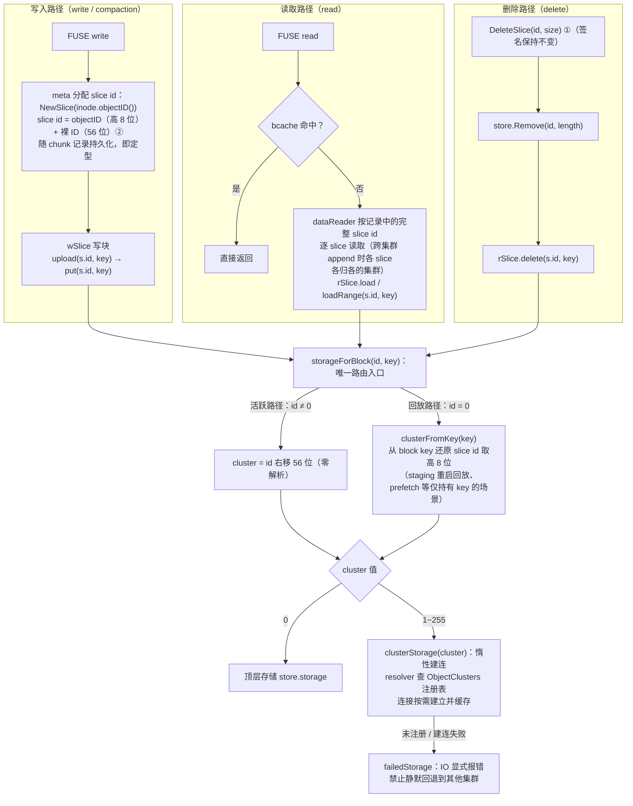

# TiKV 元数据引擎 inode 与 slice id 结构升级设计文档（inode 6+8+50 / slice id 8+56）

> 状态：设计稿（含第二阶段：多对象存储子集群与数据路由，见 §8）
> 适用范围：仅 TiKV 及 KV 族元数据引擎（`pkg/meta/tkv.go`）
> 关联分支：`poc/inode-128`
>
> **布局修订记录**：inode 位域由早期方案的 8+6+50 调整为 **6+8+50**
> （保留位缩至 6 位，object_ID 扩至 8 位，上限从 63 提升至 255）；
> slice id 新增 **8+56** 位域（高 8 位 object id，低 56 位全局唯一
> slice ID），数据面路由依据由 inode 解析改为 **slice id 自身**（见
> §8.4）。

## 1. 背景与目标

当前 JuiceFS 的 inode 是一个单调递增的 64 位整数，由全局计数器
`nextInode` 批量分配，仅用于唯一标识文件/目录，不含任何结构化语义。

随着快照、克隆、数据面多子集群（对象存储子集群）等能力的规划，
需要让 inode 本身携带少量路由与版本信息。本文档定义新的 inode 位域
划分，以及 **仅 TiKV 元数据引擎** 的生成规则改造方案。

### 1.1 新的 inode 位域划分

```
63  58 57                       50 49                             0
┌──────┬───────────────────────────┬───────────────────────────────┐
│ 保留  │ object_ID                 │ inode ID（全局唯一，单调分配）  │
│ 6 bit│  8 bit                    │  50 bit                       │
│ 恒 0  │ 0 ~ 255                   │ 计数器分配                     │
└──────┴───────────────────────────┴───────────────────────────────┘
```

- **保留位（6 bit，bit 58~63）**：预留位。本方案**不实现**快照、
  克隆等使用该字段的任何逻辑，**恒为 0**。将其置为非 0 的功能属于
  后续独立方案（且存在与回收站 inode 的冲突，见 §7 遗留待处理问题）。
- **object_ID（8 bit，bit 50~57）**：文件数据存储所在对象子集群的 ID，
  全局唯一，理论上支撑 256 个子集群。第二阶段将其启用：inode 的
  object_ID 决定**新写入数据**归属的子集群；数据一旦落盘为 slice，
  后续读、删由 slice id 自带 object id 路由（见 §1.3 与 §8.4）。
- **inode ID（50 bit，bit 0~49）**：全局唯一 inode 编号，沿用现有
  `nextInode` 计数器批量分配机制，单调递增。

### 1.2 新的 slice id 位域划分

```
63        56 55                                              0
┌───────────┬────────────────────────────────────────────────┐
│ object id │ slice ID（全局唯一，单调分配）                   │
│  8 bit    │  56 bit                                        │
└───────────┴────────────────────────────────────────────────┘
```

- **object id（8 bit，bit 56~63）**：该 slice 数据所在对象子集群的
  ID，与 inode 的 object_ID 使用同一注册表（§8.2）。
- **slice ID（56 bit，bit 0~55）**：全局唯一编号，由现有
  `nextChunk` 计数器分配，上限 `2^56`，封顶返回 `ENOSPC`。

**路由规则（本方案核心）**：读、删 slice 时，以 **slice id 高 8 位**
为唯一路由依据确定数据所在子集群；**不**根据引用该 slice 的 inode
解析 object_ID。slice id 一旦写入 chunk 记录即自证归属，全链路
（读 / 删 / compaction / 缓存 / gc 元数据）透传使用。

### 1.3 设计目标

1. inode 与 slice id 生成规则按位域组合，仅修改 TiKV（KV 族）相关
   处理逻辑，Redis / SQL 引擎行为不变。
2. 保持 TiKV 上现有的小端（LittleEndian）key 编码的全部优点：
   写入 key 在 key 空间中均匀打散，不产生单 Region 写热点。
3. **不考虑存量数据**：本方案仅适用于新建集群 / 全新卷，不提供
   存量卷的迁移或升级路径；全集群统一使用支持本特性的版本。
4. **第二阶段（§8）**：引入多对象存储子集群——初始化仅配置首个
   子集群（object_ID=0），后续通过集群配置更新追加（object_ID
   从 1 递增）；新建 inode 继承父目录的 object_ID；核心 IO 按
   slice id 路由，快速验证可行性。

## 2. 关键约束与不变量

以下不变量是本方案正确性的基础，任何后续改动不得破坏：

1. **保留位恒为 0**。
   `pkg/meta/interface.go` 中 `TrashInode = 0x7FFFFFFF10000000`，
   `IsTrash()` / `IsNormal()` 基于数值范围比较
   （`i >= TrashInode` / `i < TrashInode`）。常规 inode 的
   bit 58~63 必须为 0，才能保证新分配的 inode 全部落在
   `IsNormal()` 区间内，与回收站、内部节点互不重叠。
2. **分配器不得进位**。
   inode ID 计数到达 `2^50` 时必须显式失败（返回 `ENOSPC`），
   slice ID 计数到达 `2^56` 时同理——严禁向 object_ID 或保留位
   进位，进位会静默改变 id 的结构化语义。
3. **低位熵保持**。
   小端 key 编码下，key 的前 6 个字节加第 7 字节的低 2 位由
   50 位 inode ID 构成（byte6 的字段错位见 §3），顺序分配时
   低位先变，新 key 依然散布于整个 key 空间。这是当初 inode 采用
   LittleEndian 编码的全部动机，位域划分不能逆转它。

### 2.1 与既有保留区间的兼容性核对

| 区间 | 数值范围 | 与新位域的关系 |
| --- | --- | --- |
| 常规 inode | `[1, TrashInode)` | 新规则最大值 `(255<<50) \| ((1<<50)-1)` ≈ 2^58，远小于 `TrashInode` ≈ 2^63，安全 |
| 回收站 inode | `TrashInode + n`，由 `nextTrash` 计数器分配 | 位于保留位之上，不在 6+8+50 空间内，分配路径不变 |
| 内部节点 / detached node | 低位区间 | 不受影响 |
| slice id | 全 uint64 空间 | slice id 仅作 opaque uint64 透传（chunk 记录、sliceRefs、缓存 key），高 8 位占用不影响任何数值范围判定 |

## 3. 字节布局与 TiKV key 编码分析

### 3.1 6+8+50 的非对齐字节布局

6+8+50 **不是字节对齐**的划分，但三个字段在 64 位值内均位连续，
且字段边界（bit 50、bit 58）都落在字节内部而非横跨字节。小端 key 中
（字节 0 为最低字节）：

```
bit:   63......58 | 57......56 | 55......50 | 49 48 | 47........0
byte7: 保留位(高6)  │← object_ID 高 2 位 →│
byte6:                          │← object_ID 低 6 位 →│ [inodeID bit49~48]
byte0~5 = inode ID 低 48 位
```

即：

- `byte0~5` = inode ID 低 48 位（完整 6 字节）；
- `byte6` = [inode ID bit49~48（低 2 位）] [object_ID 低 6 位（高 6 位）]；
- `byte7` = [object_ID 高 2 位（低 2 位）] [保留位（高 6 位）]。

### 3.2 非对齐带来的影响与对策

| 影响面 | 结论 / 对策 |
| --- | --- |
| key 字节编码 | `LittleEndian.PutUint64(组合后的 uint64)` 一次写入，无对齐要求，不受影响 |
| 防写热点 | inode ID 占据 byte0~5 全部与 byte6 低 2 位，顺序分配时低位先变，打散特性完整保留 |
| 数值比较 | 无符号整数的数值序天然等于「保留位优先、其次 object_ID、最后 inode ID」的字典序，`IsTrash()` 等范围比较不受影响 |
| 原始 key 字节拆解 | **禁止**在 raw key 层面按直觉拆字段：object_ID 的正确取法是 `(uint64(key[6])>>2) \| uint64(key[7]&0x3)<<6`（byte6 高 6 位为低位、byte7 低 2 位为高位）。统一走 `Ino.objectID()` / `composeInode()` 助手，并在常量旁注释 byte6/byte7 的错位 |
| 边界防御 | compose 时对 inode ID 做 `& maxInodeID` 兜底；对 dump 导入、旧客户端、`restore` 等不可信来源的 inode，decompose 时若发现保留位非 0 或 object_ID 未注册应显式告警/拒绝，不得静默解析 |
| 性能 | 位移 + 掩码各一条指令，可忽略 |

## 4. 具体改动方案（inode）

### 4.1 位域常量与组合/拆解函数（`pkg/meta/tkv.go`）

```go
const (
	inodeReservedBits = 6
	inodeObjectBits   = 8
	inodeIDBits       = 50
	maxInodeID        = (1 << inodeIDBits) - 1
	MaxObjectID       = (1 << inodeObjectBits) - 1 // 255
	maxReserved       = (1 << inodeReservedBits) - 1

	inodeObjectShift = inodeIDBits                 // 50
	inodeReservedShift = inodeIDBits + inodeObjectBits // 58
)

// composeInode 将保留位、子集群 ID 与 50 位 inode ID 组合为完整 inode。
// 保留位字段为快照/克隆等后续功能预留；本方案不实现任何使用
// 保留位的逻辑，调用方必须恒传 0（见 §7.1 遗留待处理问题），
// 函数本身不做限制，为未来启用保留出入参。
func composeInode(reserved, objectID uint8, id uint64) Ino {
	return Ino(uint64(reserved&maxReserved)<<inodeReservedShift |
		uint64(objectID&MaxObjectID)<<inodeObjectShift | id&maxInodeID)
}

// decomposeInode 为 composeInode 的逆操作，出参返回保留位，
// 便于未来快照/克隆功能直接取用；本方案中返回值恒为 0。
func decomposeInode(ino Ino) (reserved, objectID uint8, id uint64) {
	u := uint64(ino)
	return uint8(u >> inodeReservedShift), uint8(u >> inodeObjectShift), u & maxInodeID
}

// objectID 返回数据所在对象子集群 ID。
// 仅对 IsNormal() 的 inode 有意义；trash / 内部节点不在该位域空间内。
func (ino Ino) objectID() uint8 { return uint8(uint64(ino) >> inodeObjectShift) }

func (ino Ino) inodeID() uint64 { return uint64(ino) & maxInodeID }
```

要点：

- **出入参预留**：`composeInode(reserved, objectID, id)` 三参齐备、
  `decomposeInode` 返回三元组，保留位的取值与解析通道均已打通；
  但本方案的调用点（kvMeta 的分配钩子等）**只允许传 0**，
  语义由未来方案定义。
- `composeInode` 内部对各字段掩码兜底，任一字段越界时截断到
  其位宽，不会静默污染相邻字段。
- object_ID 为完整 8 位且高位对齐（bit 50~57），`Ino.objectID()`
  无需掩码即可取全值；raw key 层的错位仅存在于 byte6/byte7（§3.2）。

`encodeInode` / `decodeInode`（`pkg/meta/tkv.go`）**保持不变**：
它们只做 uint64 的小端字节搬运，对位域无感知。

### 4.2 object_ID 的来源：Volume Format（`pkg/meta/config.go`）

object_ID 的来源在第二阶段演进为「集群注册表 + 父目录继承」
（§8.2 / §8.3）：首个子集群 object_ID 固定为 0，复用现有顶层
Storage/Bucket 字段，无需配置；注册表随 setting 持久化，append-only。

> 历史方案（已废弃）：卷级 `Format.ObjectClusterID` 单字段配置。
> 实现时该字段被注册表取代并**移除**（新建卷前提，无兼容负担）。

### 4.3 分配规则改造

现有公共分配路径（`pkg/meta/base.go`）：

```
baseMeta.nextInode() → allocateInodes() → m.en.incrCounter("nextInode", inodeBatch)
```

方案要点：**`nextInode` 计数器仍然只管理 50 位裸 inode ID**，
位域组合放在 kvMeta 层完成：

1. 采用**可选接口 + 类型断言**（与 `tkvChangelogClient` 同一模式，
   Go interface 无默认实现，不能在引擎接口上加方法）：tkv.go 定义
   `type inodeComposer interface { composeInode(ctx Context, id uint64, parent Ino) (Ino, error) }`，
   `baseMeta.nextInode(ctx, parent)` 返回前断言 `m.en`，命中则走
   位域组合，未命中（Redis / SQL）恒等返回 `Ino(n)`，行为逐字节不变。
2. `kvMeta` 实现该接口：object_ID 取父目录继承
   （`parent.objectID()`），`Context` 携带显式指定值（CLI
   `--object-id`，`ObjectIDCtxKey{}`）时覆盖继承值；object_ID
   未在注册表注册时返回 `EINVAL`；inode ID 越过 `maxInodeID`
   返回 `ENOSPC`（禁止进位）：

   ```go
   func (m *kvMeta) composeInode(ctx Context, id uint64, parent Ino) (Ino, error) {
   	if id > maxInodeID {
   		return 0, syscall.ENOSPC // inode ID 空间耗尽，显式失败，禁止进位
   	}
   	// 保留位恒传 0：本方案不实现快照/克隆逻辑（§7.1），
   	// 入参通道已预留，未来方案在此传入真实值
   	objectID := parent.objectID()
   	if v := ctx.Value(ObjectIDCtxKey{}); v != nil {
   		objectID = v.(uint8)
   	}
   	if m.getFormat().ObjectClusterByID(objectID) == nil {
   		return 0, syscall.EINVAL // 未注册的子集群
   	}
   	return composeInode(0, objectID, id), nil
   }
   ```

3. **越界处理**：封顶检查放在 `composeInode` 钩子内——批量预取的
   `[next-batch, next)` 区间越过 `maxInodeID` 时，区间内可用的
   inode ID 正常分配，越过边界后下一次分配返回 `ENOSPC`
   （不引入额外的批量截断逻辑，靠掩码兜底保证高位永不被污染）。
4. 其余分配点自动继承：`Create` / `Mkdir` / `Symlink` / `Mknod` /
   `CloneFile` 均经由 `m.nextInode(ctx, parent)`，无需逐个修改。

**不改动**的分配路径：

- trash inode（`TrashInode + next`）：位于保留位之上，不在
  6+8+50 空间内；
- session 计数器：与 inode / slice id 无关；
- slice id 计数器：见 §8.4（`nextChunk` 改管 56 位裸 ID，
  组合规则与 inode 同模式）。

### 4.4 改动清单（inode 部分）

| 文件 | 改动 |
| --- | --- |
| `pkg/meta/tkv.go` | 位域常量（6/8/50）、`composeInode` / `decomposeInode` / `objectID()` / `inodeID()`、`inodeComposer` 可选接口、`kvMeta.composeInode` 钩子（继承 + 指定 + 注册校验 + 封顶） |
| `pkg/meta/config.go` | `ObjectCluster` 注册表（§8.2）、append-only 校验 |
| `pkg/meta/context.go` | `ObjectIDCtxKey{}` + `WithObjectID()` 助手 |
| `pkg/meta/base.go` | `nextInode(ctx, parent)` 签名调整，各分配调用点传参；clone 路径传源 inode |
| `pkg/meta/dump.go` / `backup.go` | 计数器重建用 `inodeID()` 取裸 50 位 ID（混合 object_ID 时逐 inode 分解取最大裸 ID） |
| `pkg/meta/tkv_test.go` | 边界与回归用例（见 §6） |

## 5. 约束与前提

> 本方案**不考虑存量数据**：仅适用于新建集群 / 全新卷，
> 不提供存量卷的数据迁移、升级路径或新旧客户端混布支持。
> 全集群统一使用支持本特性的版本。

### 5.1 TiKV key 空间

- `encodeInode` 不变，key 字节布局仅是取值集合的变化，
  key 排序、Region 分裂、range scan 全部不受影响。
- 防热点特性（§3.2）保持：inode ID 位于低位、占据 key 前 6 字节
  与 byte6 低 2 位。

### 5.2 特殊 inode 区间

`objectID()` 仅对 `IsNormal()` 的 inode 有意义。对 trash inode
（返回无意义值）与内部节点调用该方法属于编程错误，
助手注释中需显式声明；数据面实现必须先做 `IsNormal()` 检查。

## 6. 测试计划（第一阶段：inode 位域）

按 AGENTS.md 要求，行为变更需配套单测；用例归入
`pkg/meta/tkv_test.go`（memkv 引擎与 TiKV 共享 `kvMeta` 代码路径）：

1. **位域往返**（`TestInodeBitLayout`）：`composeInode(reserved, objectID, id)` →
   `decomposeInode()` 往返无损，覆盖边界组合：
   `objectID ∈ {0, 1, 255}` × `inodeID ∈ {1, 2^49-1, 2^49, 2^50-1}`；
   并校验 `composeInode(0, ...)` 产出的 inode 高 6 位
   （保留位）恒为 0，各字段掩码兜底不互相污染。
2. **组合钩子**（`TestKVMetaInodeComposition`）：memkv 注册一个
   子集群后，`Mkdir` 分配的 inode 满足保留位==0、objectID
   等于继承/指定值、`IsNormal()==true`；未注册 object_ID 拒绝
   （`EINVAL`）。
3. **封顶行为**（`TestKVMetaInodeIDExhausted`）：将 `nextInode`
   计数器拨至 `maxInodeID`，分配一个成功（值恰为
   `composeInode(0,0,maxInodeID)`），下一个返回 `ENOSPC`。
4. **注册表校验**（`TestFormatObjectClustersValidation`）：
   追加 / 修改 / 删除 / 非连续 ID / 超过 255 个的合法性。

## 7. 遗留待处理问题（Known Issue）

### 7.1 保留位与 trash inode 的冲突

**问题**：保留位域（bit 58~63）与现有回收站机制存在数值空间
冲突。本方案通过「保留位恒为 0」绕开该冲突，但**并未解决**它；
未来任何将该字段置为非 0 的功能（快照、克隆等）落地前，
必须先处理此问题。

冲突的具体来源（`pkg/meta/interface.go`）：

1. **数值范围判定被污染**。
   `TrashInode = 0x7FFFFFFF10000000`（bit 62 置位，逼近 2^63），
   `IsTrash()` 为 `i >= TrashInode`、`IsNormal()` 为
   `i < TrashInode` 的纯数值比较。一旦常规 inode 的保留位非 0，
   其数值越大越容易被误判为回收站 inode；判定完全依赖于
   「保留位 × 2^58 与 TrashInode 的数值巧合」，语义脆弱。

2. **trash inode 派生公式占用保留位**。
   回收站 inode 由 `TrashInode + nextTrash 计数器` 派生，
   该数值的高 6 位为 `0x1F`，即 **trash inode 自身的保留位
   值非 0**。若未来按该字段区分对象类型，trash inode 会被
   解读成「保留位非 0 的对象」，与常规 inode 语义互相踩踏。

**处理方向**（供后续方案参考，本方案不实现）：

- 将 `IsTrash()` / `IsNormal()` / 内部节点判定从数值范围比较
  改为**显式位/字段判断**，使保留位与对象类型判定解耦；
- 为 trash inode 重新规划派生公式（专用位域或独立命名空间），
  避免其自然落入保留位域；
- 涉及 `TrashInode` 常量调整时，按版本兼容规范评估
  dump/load、`pkg/vfs` 及旧客户端的影响。

### 7.2 slice id 高 8 位与既有 opaque 使用的核对

slice id 在现有代码中是 opaque uint64：chunk 记录 value、
sliceRef key（BigEndian 编码）、缓存 key、`DumpedSlice` 等。
高 8 位占用后需逐处核对：

- **数值比较**：不存在针对 slice id 全值的 `>` / `<` 语义判定
  （仅相等比较与 map key），安全；
- **sliceRef BigEndian key**：高位在前，数值序天然按 object id
  分桶排列，range scan 语义不变；
- **dump / backup 计数器重建**：`nextChunk` 计数器只存 56 位
  裸 ID，重建时必须剥离高位（`sliceID()` 取法），否则恢复后
  计数器起点被抬高（尚不至于溢出，但语义错误）；
- **第三方工具**：`juicefs dump` 的 JSON 透传 uint64 原值，
  无影响。

## 8. 第二阶段：多对象存储子集群与数据路由（按 slice id）

### 8.1 需求与范围

1. 集群可配置**多个**对象存储子集群，每个子集群拥有全局唯一的
   object_ID 用于标识；
2. **初始化只配置第一个**子集群，object_ID 固定为 0；后续通过
   更新集群配置追加子集群，object_ID 从 1 开始递增；
3. **暂不实现**删除子集群的逻辑（注册表 append-only）；
4. 根目录保持现有逻辑不变：代码中 `RootInode = 1`，其 object_ID
   恒为 0，顶层创建一律从根目录继承 0；
5. 创建新文件 / 目录时，inode 的 object_ID **继承父目录**；
6. 提供命令行工具：创建目录时**指定** object_ID；
7. slice id 采用 8+56 位域（§1.2）：**读、写、删、compaction、
   缓存一律按 slice id 高 8 位路由**，不根据 inode 解析
   object_ID（最新需求，取代早期「按 inode 路由」方案）；
8. 本阶段**仅实现核心 IO** + 上述配置与命令，快速验证可行性；
   gc / fsck 等工具的影响见 §8.9。

### 8.2 子集群注册表

**Format 扩展**（`pkg/meta/config.go`）：

```go
type ObjectCluster struct {
	ID           uint8  // 全局唯一；1~255 为显式子集群，0 为隐式初始集群
	Storage      string
	Bucket       string
	AccessKey    string `json:",omitempty"`
	SecretKey    string `json:",omitempty"`
	SessionToken string `json:",omitempty"`
	StorageClass string `json:",omitempty"`
}

type Format struct {
	...
	// 显式子集群注册表（ID 从 1 连续递增）；cluster 0 隐式等于
	// 顶层 Storage/Bucket 字段，不入注册表
	ObjectClusters []ObjectCluster `json:",omitempty"`
}
```

- **cluster 0 隐式**：`ObjectClusterByID(0)` 恒返回顶层
  Storage/Bucket 视图——避免注册表内顶层存储副本与 `config`
  修改顶层存储后脱节。`format` 命令无需任何新参数。
- **追加子集群**：`juicefs config --add-object-cluster`（§8.7），
  ID 自动分配 `max(已用)+1`；上限 255（8 位空间）。
- **append-only 不变量**：已存在的 (ID → 配置) 不允许修改与删除
  （`Format.update()` 校验）——已写入数据的对象 key 只在该
  子集群上有效，改配置即数据丢失。Secret 等字段沿用现有
  `Encrypt`/`Decrypt`/`RemoveSecret` 机制逐条处理。
- **追加时的加解密与比较时机**：`config --add-object-cluster` 追加
  前先 `Decrypt()` 整个 format、写回时由 `Encrypt()` 重新加密整表；
  重新加密使用随机 nonce，会使既有条目的密文变化，因此 append-only
  校验必须在**解密后按明文**比较（`objectClustersAppendOnly`），
  否则第二次追加会被误判为「修改既有条目」而失败。
- **生效路径**：注册表随 setting 持久化；挂载客户端通过现有的
  `reloadFormat()`（`pkg/meta/base.go`，后台热加载）感知新增
  子集群，无需重启。

### 8.3 元数据改动：object_ID 的继承与指定

**inode 分配钩子**（§4.3）：object_ID 取父目录继承
（`parent.objectID()`），`Context` 携带显式指定值
（`ObjectIDCtxKey{}`）时覆盖继承值；object_ID 未注册返回 `EINVAL`。

- **根目录**：`RootInode=1` 原样保留，其 object_ID 为 0
  （`Ino(1).objectID() == 0` 自然成立，无需特判）。
- **CloneFile 特殊规则**：新 inode **继承源 inode 的 object_ID**
  而非父目录——clone 复制的是 chunk 记录，新旧 inode 共享同一批
  slice id；而 slice id 自带数据归属（§8.4），继承规则保证
  「新写入的数据」与「共享的历史数据」落在同一子集群。
- **object_ID 是 inode 的固有属性**：创建时确定，此后不变
  ——它只决定「该 inode 新写入数据」的 slice id 前缀；
  `Rename` 不改变 inode 的 object_ID。
- 已存在目录的 object_ID **不可修改**，CLI 只支持新建目录时指定。

### 8.4 数据面路由（`pkg/chunk`）——按 slice id

**slice id 分配与定型**（`pkg/meta`）：

- `nextChunk` 计数器改为**只管理 56 位裸 slice ID**；
- slice id 的组合放在 kvMeta 层完成（与 inode 同模式）：
  `slice id = uint64(objectID)<<56 | bareID`，bareID 越过
  `2^56-1` 返回 `ENOSPC`（禁止进位）；
- object_ID 来自**分配时刻的写入方**：`Write`（持有文件 inode）
  与 compaction（持有 chunk 所属 inode）调用 slice 分配时传入
  `inode.objectID()`；
- **slice id 一经分配即定型**：随 chunk 记录持久化，此后该
  slice 的读、删、缓存、compaction 输入全部按其高 8 位路由；
  早期方案中 `meta.Slice` 增加 `ObjectID` 字段、消息参数扩展、
  对象 key 集群前缀的设计**全部废弃**。

**三条 IO 路径的路由依据**：

| 路径 | 路由依据 | 说明 |
| --- | --- | --- |
| 写 | 分配时刻定型 | slice id 生成时嵌入写入 inode 的 object_ID；上传路径 `cachedStore.put` 按 `clusterFromSliceID(id)` 选择后端 |
| 读 | slice id 高 8 位 | `dataReader.readSlice` 按 `s.Id` 解析 object id 建连路由；同一文件引用多个历史 slice（跨集群 append 场景）时逐 slice 各归各的集群 |
| 删 | slice id 高 8 位 | `DeleteSlice` 消息**无需参数扩展**（维持 `(id, size)` 原签名）：meta 层发出的 id 已含前缀，回调 `Remove(id, size)` 内部按 id 路由 |

**当前 IO 流程图**（写入 / 读取 / 删除）：



> ① 消息签名保持 `(id, size)` 不变；unlink、覆盖写清理、trash 清理、
> gc 直删均经此消息，id 自带路由前缀，无需 inode 上下文。
> ② 裸 ID 来自 `nextChunk` 计数器（56 位），越界返回 `ENOSPC` 禁止
> 进位；compaction 分配新 slice 走同一入口，object_ID 取原 chunk
> 所属 inode。

**关键收益（相对早期按 inode 路由方案）**：

1. `meta.Slice` 结构、`DeleteSlice`/`CompactChunk` 消息签名、
   cmd / SDK 的 `OnMsg` 回调**全部保持原样**，兼容面归零；
2. 早期方案需回退 cluster 0 的后台路径（延迟删除清理、trash
   slices 清理、gc 直删）现在**天然按 slice id 正确路由**，
   无需逐个回退；
3. trash / fsck / dump 等只有 slice id 没有 inode 上下文的场景
   全部可正确路由。

**多后端持有**：`cachedStore` 增加按 object id 的惰性建连
router（`clusterStorages map[uint8]object.ObjectStorage` +
`SetClusterResolver`），由 cmd 层用注册表实现 resolver；
连接按需建立并缓存，`reloadFormat` 感知注册表后新 object id
自动可建连。

**路由实现（两级）**：

- **活跃路径（rSlice 读 / 写 / 删）直接按 slice id 路由**：
  `storageForBlock(id, key)` 对 `id` 非 0 时直接取
  `clusterFromSliceID(id) = id>>56` 选择后端，零字符串解析；
- **仅持有 key 的回放路径**（staging 重启回放、prefetch、
  `FillCache` 之外的延迟清理等）传 `id=0`，回退
  `clusterFromKey(key)` 从 block key 文本还原 slice id 再取高
  8 位——还原出的正是同一个 id，与活跃路径结果一致，路由
  真相来源始终是 slice id 本身，而非 inode 或 key 的目录结构；
- 两级收敛到同一个 `storageForBlock` 入口，新增 IO 路径不会漏
  路由。

**对象 key 与缓存 key 不变**：对象 key 仍由 slice id 裸值构成
（`chunks/...`），不嵌入 object_ID——object id 由 slice id
本身携带，key 在各子集群内自洽。本地读缓存（`bcache`）与
staging 的 key 由完整 slice id 构成，高 8 位天然把不同子集群
的同裸 ID slice 分开，无冲突。

**CompactChunk**：compaction 为合并结果分配**新 slice id**，
其 object id 取原 chunk 所属 inode 的 object_ID（发出点持有
inode），合并后的数据写入目标子集群；对参与合并的输入 slice
按各自 id 路由读取。

### 8.5 正确性不变量与边界

**不变量**（本阶段正确性前提，后续改动不得破坏）：

1. **slice id 定型后不可变**。slice id 高 8 位是数据归属的唯一
   真相来源；任何代码不得对已持久化的 slice id 重新解释或改写
   其 object id 字段。
2. **同 inode 的写入恒写向当前 object_ID**。inode 的 object_ID
   创建后不变（§8.3），因此同一 inode 生命周期内分配的 slice id
   前缀恒定；不存在同一文件的数据散落多集群的普通路径
   （append 旧数据引用历史 slice 除外，读路径已按 slice id
   逐个路由，无需 inode 参与）。
3. **裸 ID 全局唯一**。56 位裸 slice ID 由全局计数器分配，
   高位前缀不参与唯一性——不同子集群不存在「同裸 ID」的碰撞
   可能，sliceRef / chunk 记录中的完整 id 即全局键。
4. **trash**：trash inode 不在 inode 位域空间内；trash 内文件的
   数据路由按 **chunk 记录中的 slice id**（自带归属）进行，
   restore 读、cleanupTrash 删均无需解析原 inode。
5. **多后端生命周期**：注册表 append-only（§8.2）保证已建连的
   后端配置永不失效；惰性建连只在某 object id 首次使用时发生；
   resolver 报错（未注册/建连失败）时 IO 显式失败，禁止静默
   回退到其他集群。

**边界**（明确排除）：

- 硬链接：多个 dentry 指向同一 inode，object_ID 唯一，天然安全；
- `--shards` 与本特性**正交**：shards 是单子集群内多 bucket 的
  hash 分散，object_ID 是显式子集群归属，二者不混用；
- 跨集群去重 / 数据均衡迁移：本阶段不做；同一内容在两个子集群
  各自的 slice id 不同，去重需 slice 级归属元数据（§9）；
- 快照 / 克隆（保留位非 0）：见 §7.1 遗留问题，未解决前不可启用。

### 8.6 改动清单

| 文件 | 改动 |
| --- | --- |
| `pkg/meta/config.go` | `ObjectCluster` / `ObjectClusters` 注册表（上限 255、append-only 校验、`ObjectClusterByID`） |
| `pkg/meta/context.go` | `ObjectIDCtxKey{}` + `WithObjectID()` 助手 |
| `pkg/meta/base.go` | `nextInode(ctx, parent)` 签名调整；clone 路径传源 inode；slice 分配调用点（Write / compact）传 object_ID |
| `pkg/meta/tkv.go` | inode 6+8+50 位域助手与分配钩子（§4.1/§4.3）；slice id 8+56 位域助手（`composeSliceID` / `sliceID()` / `sliceObjectID()`）与分配钩子 |
| `pkg/meta/interface.go` | `Slice` 结构**保持不变**（无 ObjectID 字段）；`DeleteSlice` / `CompactChunk` 消息签名不变 |
| `pkg/meta/dump.go` / `backup.go` | `nextInode` 与 `nextChunk` 计数器重建均取裸 ID（`inodeID()` / `sliceID()`） |
| `pkg/chunk/chunk.go` | `ChunkStore` 接口签名恢复原样（id 即含路由信息）；新增 `SetClusterResolver` |
| `pkg/chunk/cached_store.go` | 惰性建连 router；`storageForBlock(id, key)` 两级路由（put/get/delete/staging load 全覆盖）：活跃路径按 slice id 直连，回放路径回退 key 解析 |
| `pkg/vfs/reader.go` / `writer.go` / `compact.go` / `fill.go` | **移除**按 inode 路由的传参（早期方案），路由全部下沉到 chunk 层 |
| `cmd/config.go` | `--add-object-cluster` 等 flag（上限 255） |
| `cmd/mkdir.go`（新增） | ADMIN 命令：创建目录并指定 object_ID（§8.7） |
| `cmd/mount.go` | `SetClusterResolver` 接线（注册表 + `clusterFor` 视图建连）；`OnMsg` 回调**保持原签名** |
| `pkg/chunk/cluster.go`（新增） | `clusterFromSliceID` / `clusterFromKey` 解析助手、`storageForBlock` / `storageForKey` 路由入口、失败存储包装（路由失败显式报错） |

### 8.7 命令行工具

**追加子集群**——复用 `juicefs config`：

```sh
# 查看当前注册表
juicefs config META-URL
# 追加子集群（ID 自动分配为 max(已用)+1，从 1 递增）
juicefs config META-URL --add-object-cluster \
    --storage s3 --bucket https://b2.s3.region.amazonaws.com \
    --access-key AK --secret-key SK
```

- 仅支持**追加**，不支持修改 / 删除既有条目（append-only，
  违反时报错退出）；
- 命令侧对 `--add-object-cluster` 场景屏蔽顶层
  `--storage/--bucket/--access-key/--secret-key/--session-token`
  的常规修改语义（这些 flag 归新子集群所有）；
- 追加前对目标存储做连通性测试（现有 `test()` 路径）；
- ID 分配与 `≤255` 上限校验在命令侧完成，meta 层
  `validateObjectClusters()` 再做最终校验（双保险）；
- 写入 setting 后，各挂载点经 `reloadFormat` 自动感知（§8.2）。

**创建指定 object_ID 的目录**——新增 ADMIN 子命令
`cmd/mkdir.go`（当前 CLI 无 mkdir 命令，需新建）：

```sh
# 在 /data 下创建目录，其 inode 的 object_ID 指定为 2
juicefs mkdir META-URL /data/dirA --object-id 2
```

- 校验分层：`≤255` 由命令侧 flag 校验；object_ID 是否已注册由
  meta 层在 inode 分配时校验（`composeInode` 未命中注册表返回
  `EINVAL`），命令侧不重复判断；
- 命令侧**不做**元数据引擎类型判断：本方案的约束是「改动范围
  限于 TiKV/KV 族实现」，不在 CLI 层拦截非 TiKV 引擎；
- 实现：解析路径拿到父目录 inode，`Mkdir` 时通过
  `ObjectIDCtxKey{}` Context 传入指定值（§8.3）；
- 该目录下后续新建的文件 / 目录默认继承 object_ID=2；
- 已存在目录的 object_ID **不可修改**（§8.3），命令只支持新建。

### 8.8 测试计划（第二阶段）

沿用 memkv（元数据）+ mem 对象存储组合做快速验证：

1. **slice id 位域**：`composeSliceID(reserved=0, objectID, bareID)`
   → `sliceID()` / `sliceObjectID()` 往返无损；bareID 封顶
   `ENOSPC`；dump→load 后 `nextChunk` 计数器为裸 ID。
2. **写入路由**：object_ID=1 的目录写入文件后，slice id 高 8 位
   ==1，对象仅出现在子集群 1 的存储上；object_ID=0 子树写入
   落在顶层存储。
3. **读路由**：读取上述文件内容逐字节正确；构造跨集群 append
   （对旧文件追加，新旧 slice 分属两集群）后整文件读取正确。
4. **删路由**：删除文件后，对应子集群上的对象被 `Remove`，
   另一集群无残留；延迟删除 / trash 清理路径同样按 slice id
   命中正确集群。
5. **继承**：根目录创建 → 0；`--object-id 2` 目录下创建 → 2；
   CloneFile → 新 inode 继承源 object_ID，克隆体读到的共享
   slice 按源集群路由正确。
6. **Rename 语义**：跨 object_ID 子树 `Rename` 后，inode 的
   object_ID 与数据位置不变，读取仍正常。
7. **Compaction**：object_ID=2 的文件触发 compaction 后，新
   slice id 高 8 位 ==2，数据落在子集群 2，读取与合并前一致。
8. **注册表**：`config --add-object-cluster` 追加 ID 依次 1、2；
   修改 / 删除既有条目报错；指定未注册 object_ID 的 mkdir 被
   `EINVAL` 拒绝。
9. **隔离回归**：object_ID=0 子树行为与改造前完全一致（现有
   全部测试经此路径回归）。

集成验证（手动）：真实 minio 双桶环境，`juicefs format`（单桶）
→ mount → 写入 → `config --add-object-cluster`（第二桶）→
`mkdir --object-id 1` → 写入 → 校验两桶对象分布与读取正确性。

### 8.9 本阶段不实现的功能及其影响（明确挂账）

slice id 自带路由后，早期方案的多项挂账被自然解决或缓解；
仍有以下事项需知晓：

| 功能 | 现状 | 影响 |
| --- | --- | --- |
| `juicefs gc` / `fsck` | 仅列举**顶层存储（cluster 0）**的对象（`cmd/gc.go` 单 store） | 删除方向已按 slice id 正确路由（不会误删他集群数据）；但**列举方向**只能覆盖 cluster 0：子集群 ≥1 上的孤儿对象不被发现。gc 对象列举需扩展为遍历注册表（挂账） |
| `juicefs dump` / `backup` | dump/load 原样透传 uint64 inode 与 slice id | 恢复后只要注册表一致即可正确读写；计数器重建用裸 ID（§7.2）；load 侧应校验 inode/slice 引用的 object id 均已注册（挂账） |
| `juicefs warmup` | 走读路径，按 slice id 路由 | 天然正确，无需改动 |
| 跨集群去重 / 数据迁移 | 未实现 | 同一内容在两集群各有独立 slice id；需 slice 级归属元数据（§9） |
| `juicefs destroy` / `rmr` / 后台清理 | 删除消息按 slice id 路由 | 早期方案的「后台清理回退 cluster 0」挂账**已解决** |

此外，本 POC **不强制抬高 `MinClientVersion`**：多子集群特性依赖
「全集群统一使用支持本特性的版本」（§5），旧客户端混布不受支持；
`dump` / `backup` / `gc` 的多子集群支持按上表挂账，本阶段不实现。
`dump` / `backup` 计数器重建对 inode / slice id 的裸 ID 剥离
（§7.2）当前对全部引擎无条件生效，非 KV 引擎仅在计数器越过
`2^50` / `2^56` 时才有差异，本阶段不做引擎区分。

## 9. 后续扩展（不在本方案范围）

- **slice 级归属元数据 / 对象列举扩展**：为 gc / fsck 补齐
  多子集群对象列举与精确校验（§8.9）。
- **数据迁移 / 再均衡**：按目录树或容量阈值把数据搬到其他
  子集群；迁移需改写 chunk 记录中的 slice id 前缀或引入
  重写式迁移（slice id 定型不变量的唯一例外，需独立方案）。
- **分子集群用量统计 / 配额**：按 object_ID 聚合各子集群的
  容量与 inode 用量，支撑运维观测与子集群级配额。
- **快照 / 克隆**：启用 inode 保留位。**前置条件是先解决
  §7.1 的遗留问题**，此外还需评估 dump/load 与
  `MinClientVersion`。
- **删除子集群**：先迁移（上一条）后摘除，注册表从 append-only
  放宽为可收缩。

